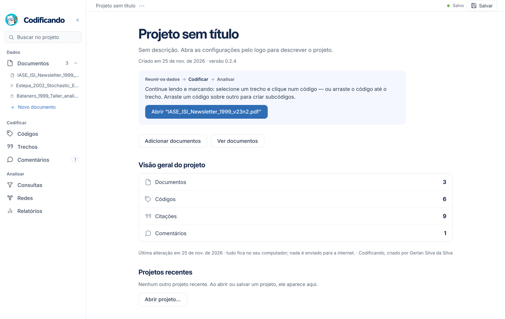
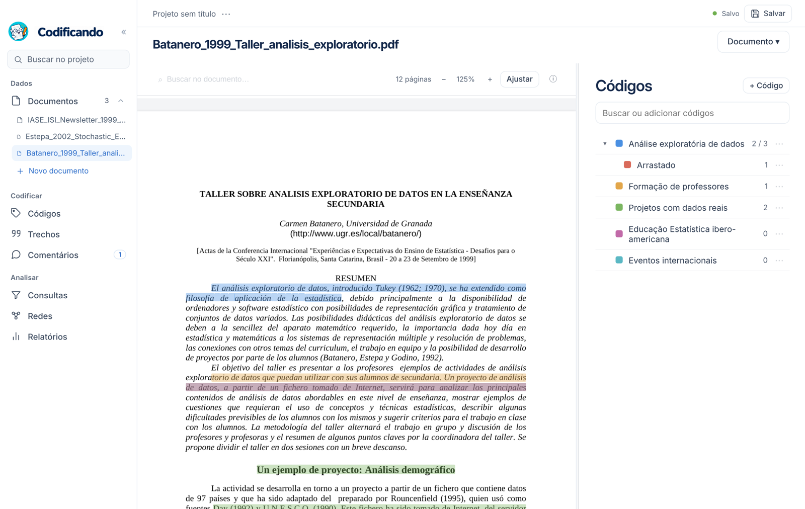

<p align="center">
  
</p>

<h1 align="center">Codificando</h1>

<p align="center">
  Análise qualitativa de dados para quem está começando na pesquisa —<br>
  do primeiro trecho marcado à rede de relações.
</p>

<p align="center">
  <a href="docs/GUIA-RAPIDO.md">Guia rápido</a> ·
  <a href="CHANGELOG.md">Novidades</a> ·
  <a href="#baixar">Baixar</a> ·
  <a href="#autoria-e-como-citar">Como citar</a>
</p>


Importa PDF, DOCX, TXT e RTF; codifica direto na página do PDF; organiza códigos em
hierarquia; reúne trechos, consultas, comentários, redes e relatórios. Serve para análise
de conteúdo, análise temática, grounded theory e fenomenologia hermenêutica.
Aplicativo **100% local** para macOS (Apple Silicon) e Windows (x64): os dados não saem do
computador.

## Como funciona

| Etapa | O que você faz | Onde |
|---|---|---|
| **1. Reunir os dados** | Importa entrevistas, artigos, documentos | Documentos |
| **2. Codificar** | Seleciona trechos e arrasta até os códigos, como no ATLAS.ti | Editor, Códigos, Trechos |
| **3. Analisar** | Agrupa, cruza e relaciona os códigos | Consultas, Redes, Relatórios |

- **Arrastar e soltar**: seleção → código, código → trecho, código → código
  (subcódigo ou mesclar) e, nas Redes, nó → nó para criar uma relação.
- **Modo Área**: um retângulo sobre figuras, gráficos e quadros do PDF vira citação, com
  miniatura do recorte.
- **Tela inicial** com Novo projeto, Abrir e Recentes. Não é obrigatório criar um projeto
  antes: tudo é salvo sozinho, e um arquivo apagado gera um aviso, não um projeto vazio.
- **Próximo passo** sempre visível na tela do projeto.

O passo a passo com imagens está no [Guia rápido](docs/GUIA-RAPIDO.md).

## Sobre esta versão

Esta versão do aplicativo usa **Tauri 2 + Rust** no lugar do antigo shell Swift/WKWebView, mantendo o frontend React/Vite
e o mesmo formato de dados do aplicativo anterior.


## Autoria e como citar

Criado e mantido por **Gerlan Silva da Silva** ([ORCID 0000-0002-9996-9983](https://orcid.org/0000-0002-9996-9983)).

Ao usar o Codificando em pesquisas, cite:

> SILVA, Gerlan Silva da. *Codificando*: software para análise qualitativa de dados. Versão 0.3.0. [S. l.], 2026. Disponível em: https://github.com/gerlansilva/codificando.

## Baixar

> O repositório é **privado**: os instaladores e o manual nas releases ficam visíveis apenas
> para quem tem acesso a ele.

Os instaladores e o manual estão em
[github.com/gerlansilva/codificando/releases](https://github.com/gerlansilva/codificando/releases):

- macOS (Apple Silicon): `Codificando_0.3.0_aarch64.dmg`
- Windows (x64): `Codificando_0.3.0_x64-setup.exe` (NSIS) ou `.msi`
- Manual: `Codificando-manual-0.2.4.pdf` (ainda da versão 0.2.4; as novidades da 0.3.0 estão no
  [Guia rápido](docs/GUIA-RAPIDO.md))

## Aviso de segurança do sistema

O app é gratuito e não tem mensalidade, conta em loja nem telemetria. O aviso que o macOS e o
Windows mostram na primeira abertura não é um vírus: é a ausência de um **certificado de
desenvolvedor** (assinatura de código), que custa uma anuidade e existe para o sistema saber
quem publicou o arquivo. Os instaladores daqui não têm esse certificado.

**macOS** — o sistema diz que o app não pode ser verificado:

1. Abra o `.dmg` e arraste o Codificando para **Aplicativos**.
2. No Finder, clique no Codificando com o botão direito e escolha **Abrir** → **Abrir**.
3. Se o macOS 14 ou 15 insistir, vá em **Ajustes do Sistema → Privacidade e Segurança** e
   clique em **Abrir mesmo assim**.
4. Se aparecer **"o Codificando está danificado e não pode ser aberto"**, rode no Terminal:
   `xattr -cr /Applications/Codificando.app` e abra de novo.

Desde a versão 0.3.0 o app sai com **assinatura ad hoc** (gratuita, sem conta de
desenvolvedor). Ela não tira o aviso, mas faz o macOS mostrar o caminho normal de
"Abrir mesmo assim" em vez da mensagem de app danificado, que aparecia nos `.dmg` das
versões 0.2.x baixados pelo navegador.

**Windows** — o SmartScreen diz "O Windows protegeu o computador":

1. Clique em **Mais informações**.
2. Clique em **Executar assim mesmo**.
3. No `.msi`, se aparecer aviso do Windows Installer, confirme em **Executar**.

Depois da primeira execução o aviso não volta. O mesmo texto está em
[docs/COMO-ABRIR.txt](docs/COMO-ABRIR.txt), anexado a cada release para quem receber o
instalador por outro caminho. Assinar e notarizar exige uma conta paga
(Apple Developer Program, US$ 99 por ano; certificado Windows, a partir de US$ 200 por ano) —
veja [docs/DISTRIBUICAO.md](docs/DISTRIBUICAO.md) para o caminho completo, caso um dia valha
a pena distribuir fora do grupo de pesquisa.

## Capturas

Tela inicial: novo projeto, abrir, recentes e créditos.


Visão do projeto com o **próximo passo** e os números do estudo.



Codificação direta sobre a página do PDF, com os códigos à mão.



Livro de códigos hierárquico, com cores, definições e contagens.


Trechos codificados, com texto e comentário legíveis e ações em lote.


Consultas que combinam códigos.


Rede de relações: arraste nós, solte um sobre outro para relacioná-los e exporte em SVG,
PNG ou figura de artigo de 16 cm.


Relatórios com exportações agrupadas por uso (Word, HTML, CSV, TXT).


As capturas da versão 0.2.4 usadas no manual em PDF continuam em `docs/manual/capturas/`.

## Requisitos

- macOS 11+ ou Windows 10/11 (x64)
- Node.js 22.22+ (recomendado 24 LTS)
- Rust (stable); no macOS, Xcode Command Line Tools

## Desenvolvimento

```bash
npm install
npm run app          # tauri dev (abre a janela nativa)
```

Somente a interface no navegador (sem ponte nativa, dados em localStorage):

```bash
npm run dev
```

## Build

```bash
npm start            # tauri build (sem artefatos do updater) + abre o .app
# build assinado, com a chave do updater:
npx tauri build
```

Artefatos no macOS:

- `src-tauri/target/release/bundle/macos/Codificando.app`
- `src-tauri/target/release/bundle/dmg/Codificando_0.3.0_aarch64.dmg`

No Windows, o mesmo comando gera:

- `src-tauri\target\release\bundle\nsis\Codificando_0.3.0_x64-setup.exe`
- `src-tauri\target\release\bundle\msi\Codificando_0.3.0_x64_en-US.msi`

Assinatura, notarização, atualizações automáticas e instalação local estão em
[docs/DISTRIBUICAO.md](docs/DISTRIBUICAO.md). Como o app está configurado para
gerar artefatos do updater, um build local sem a chave privada precisa desligá-los
com `--config src-tauri/tauri.ci.conf.json` (o `npm start` já faz isso).

## Testes

Os testes de unidade ficam em `src/lib/__tests__/` e usam Vitest. Cobrem a
hierarquia de códigos, o parser de transcrições, a busca tolerante a acentos,
os utilitários de página e as exportações DOCX/HTML.

```bash
npm test             # executa uma vez (vitest run)
npm run test:watch   # modo observação
npm run test:coverage # relatório de cobertura de src/lib
```

O ambiente padrão é `node`; apenas os testes que dependem de APIs do navegador
declaram `// @vitest-environment jsdom` no topo do arquivo. A geração do DOCX
roda em `node` e verifica que o Blob resultante tem bytes.

## Instalador Windows

Um `.exe`/`.msi` confiável precisa ser compilado no Windows (WebView2, MSI e
NSIS), portanto não é gerado no macOS. O workflow `.github/workflows/ci.yml`
faz isso no GitHub Actions:

1. Envie a branch para o GitHub e abra um pull request (ou rode o workflow
   manualmente em **Actions → CI → Run workflow**).
2. O job `build-windows` roda em `windows-latest` e usa
   `tauri-apps/tauri-action` para gerar os instaladores.
3. Ao final, baixe o artefato `codificando-windows-installer` na página da
   execução. Ele contém:
   - `Codificando_0.3.0_x64-setup.exe` (NSIS)
   - `Codificando_0.3.0_x64_en-US.msi` (MSI)

O mesmo workflow também valida os testes (`test`), o `cargo check` (`rust`) e
gera o `.dmg` no job `build-macos`, disponível no artefato
`codificando-macos-dmg`.

Para gerar localmente em uma máquina Windows:

```bash
npm ci
npm run tauri build
```

## Dados

Os dados ficam no diretório de dados do sistema:

```
macOS    ~/Library/Application Support/Investigando/
Windows  %APPDATA%\Investigando\
  investigando.json      # projeto atual
  files/                 # PDFs importados
  backups/               # snapshots automáticos por projeto
```

O app lê e grava o mesmo formato do Codificando anterior, então os projetos existentes
abrem sem migração. Projetos `.investigando` podem ser abertos/salvos pelo menu do projeto.
Em outra máquina, copie a pasta inteira para manter arquivos e backups.

## Arquitetura

- `src/` — React 18 + Vite (interface, editor de PDF com PDF.js, codebook, relatórios).
- `src/lib/bridge.js` — ponte única para Tauri; mantém fallback para navegador e para os
  shells antigos (Swift/Electron).
- `src-tauri/src/lib.rs` — comandos nativos: leitura/gravação do projeto, binários,
  seletores de arquivos, conversão `.doc`/`.rtf` via `textutil` e impressão.
- `src-tauri/tauri.conf.json` — janela, bundle e identificador.

## Documentação

- [Guia rápido](docs/GUIA-RAPIDO.md) — passo a passo para iniciantes.
- [Registro de mudanças](CHANGELOG.md).
- [Diagnóstico de usabilidade](docs/UX-DIAGNOSTICO.md) — análise da interface, comparação
  com o webQDA e perfis por método.
- [Rodada com PDFs reais](docs/UX-RODADA-PDF.md) — teste de uso com três PDFs acadêmicos.
- [Distribuição](docs/DISTRIBUICAO.md) — assinatura, notarização e atualizações.

## Observações

- A impressão usa o diálogo nativo do sistema (`WebviewWindow::print`).
- No macOS, `.doc` e `.rtf` são convertidos com o `textutil` do sistema e o OCR usa o
  Apple Vision. No Windows, importe PDF ou `.docx`; `.doc`/`.rtf` e OCR ficam indisponíveis.
- O diretório `electron/` é legado e não participa do build Tauri.
- O instalador Windows sai sem certificado de desenvolvedor; o SmartScreen pode pedir
  “Mais informações → Executar assim mesmo” no primeiro uso.
