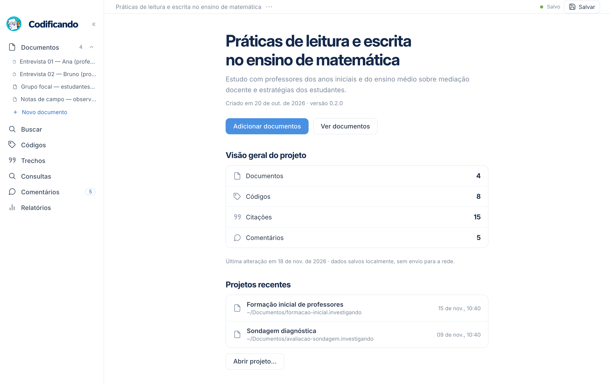
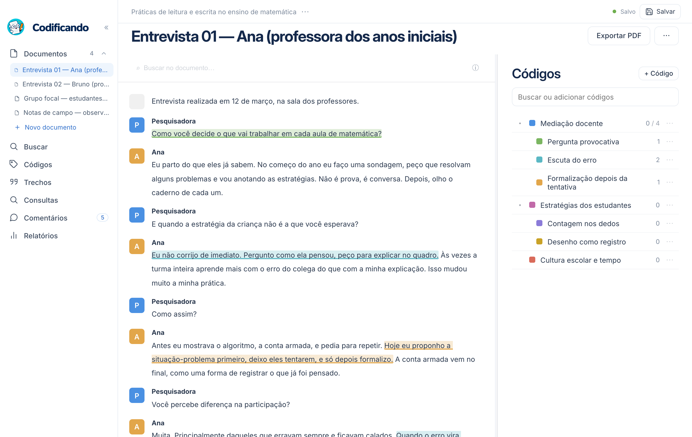
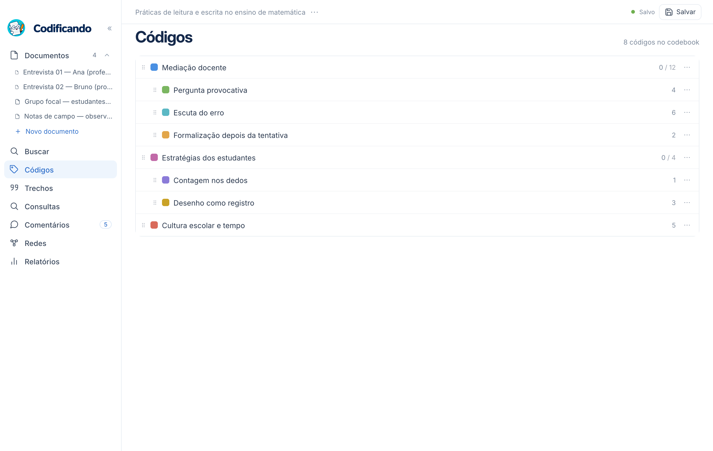
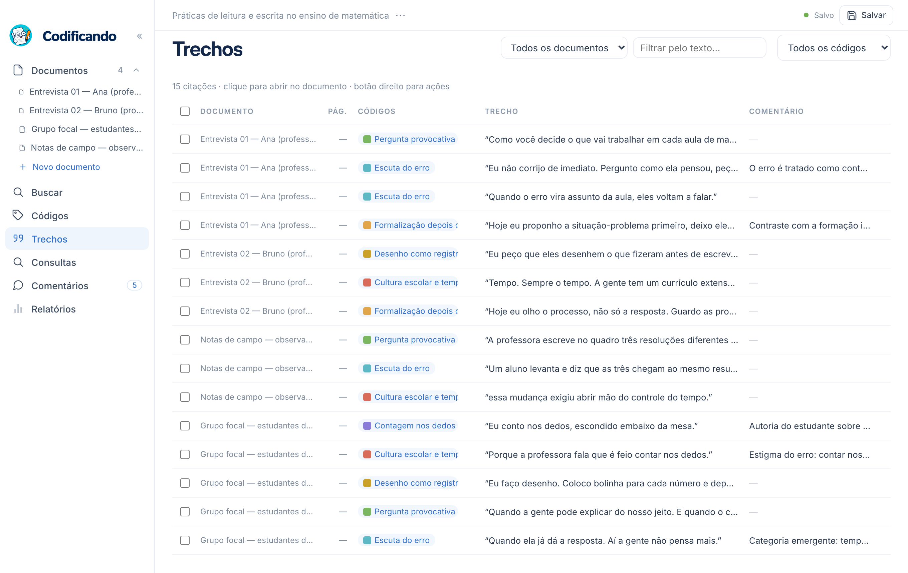
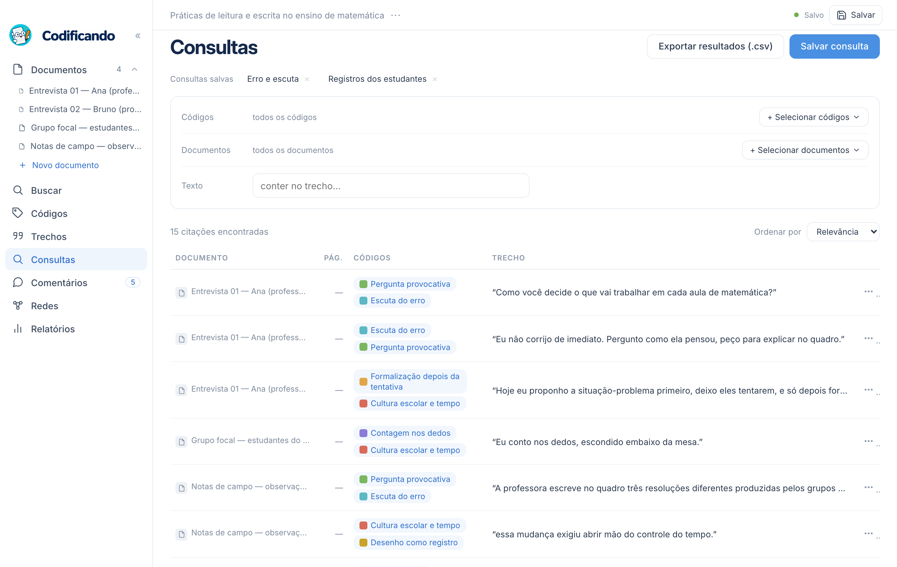
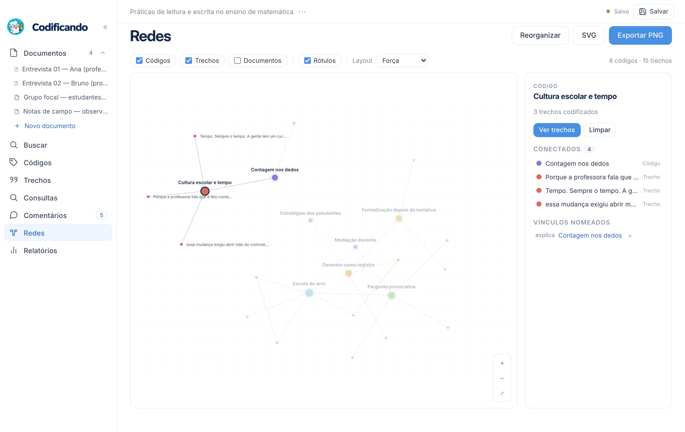
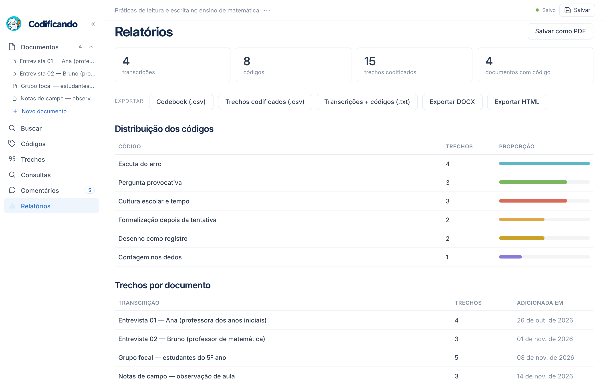
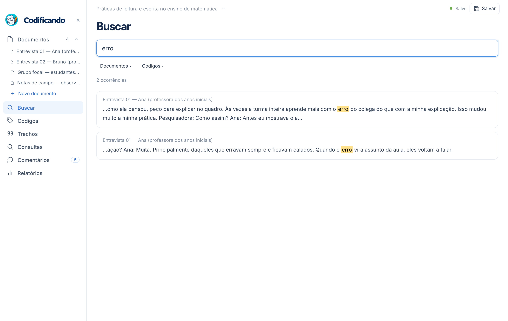
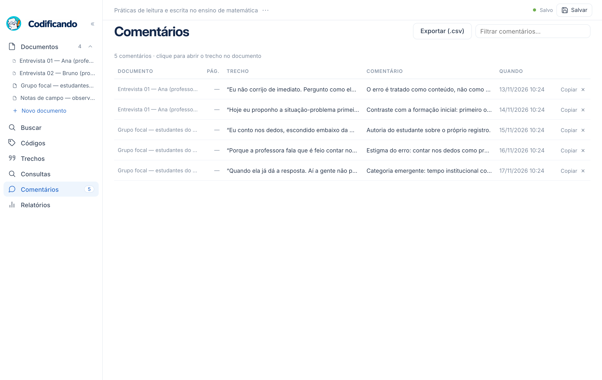
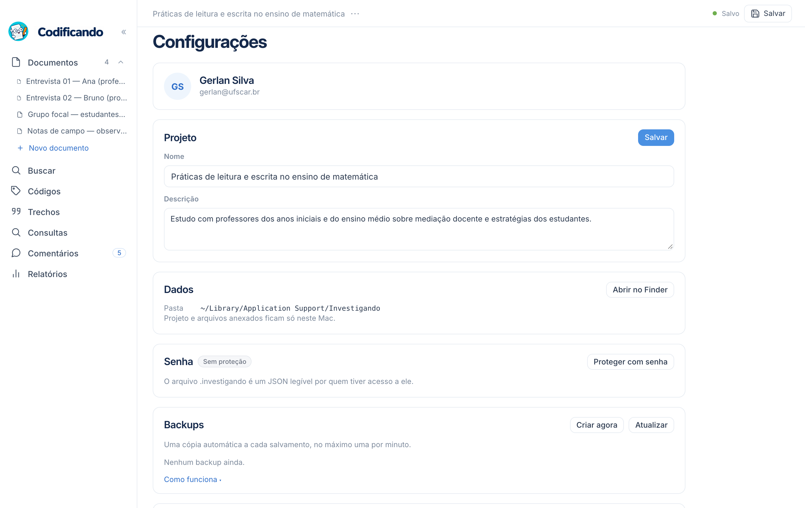

# Codificando (Tauri)

Análise qualitativa de dados — importação de PDF/DOCX/TXT/RTF, codificação direta na página
do PDF, codebook hierárquico, trechos, consultas, comentários, relatórios e busca.
Aplicativo 100% local para macOS (Apple Silicon) e Windows (x64).

Esta versão substitui o shell Swift/WKWebView por **Tauri 2 + Rust**, mantendo o frontend React/Vite
e o mesmo formato de dados do aplicativo anterior.

## Baixar

Os instaladores e o manual estão em
[github.com/gerlansilva/codificando/releases](https://github.com/gerlansilva/codificando/releases):

- macOS (Apple Silicon): `Codificando_0.2.4_aarch64.dmg`
- Windows (x64): `Codificando_0.2.4_x64-setup.exe` (NSIS) ou `.msi`
- Manual: `Codificando-manual-0.2.4.pdf`

## Aviso de segurança do sistema

O app é gratuito e não tem mensalidade, conta em loja nem telemetria. O aviso que o macOS e o
Windows mostram na primeira abertura não é um vírus: é a ausência de um **certificado de
desenvolvedor** (assinatura de código), que custa uma anuidade e existe para o sistema saber
quem publicou o arquivo. Os instaladores daqui não têm esse certificado.

**macOS** — o sistema diz que o app não pode ser verificado:

1. Abra o `.dmg` e arraste o Codificando para **Aplicativos**.
2. No Finder, clique no Codificando com o botão direito e escolha **Abrir** → **Abrir**.
3. Se o macOS 14 ou 15 insistir, vá em **Ajustes do Sistema → Privacidade e Segurança** e
   clique em **Abrir mesmo assim**.
4. Como último recurso, no Terminal:
   `xattr -dr com.apple.quarantine /Applications/Codificando.app`

**Windows** — o SmartScreen diz "O Windows protegeu o computador":

1. Clique em **Mais informações**.
2. Clique em **Executar assim mesmo**.
3. No `.msi`, se aparecer aviso do Windows Installer, confirme em **Executar**.

Depois da primeira execução o aviso não volta. Assinar e notarizar exige uma conta paga
(Apple Developer Program, US$ 99 por ano; certificado Windows, a partir de US$ 200 por ano) —
veja [docs/DISTRIBUICAO.md](docs/DISTRIBUICAO.md) para o caminho completo, caso um dia valha
a pena distribuir fora do grupo de pesquisa.

## Capturas

Visão do projeto, com os documentos na barra lateral e os números do estudo.



Codificação direta sobre a página do PDF, com os códigos à mão e os trechos já marcados.



Codebook hierárquico, com cores, definições e contagem por código.



Trechos codificados, filtráveis por código, documento e busca.



Consultas salvas que combinam códigos e respondem "quais trechos sustentam esta afirmação".



Rede de relações: coocorrência de códigos, citações e vínculos nomeados, com foco por código
e exportação em SVG, PNG ou figura de artigo de 16 cm.



Relatórios com contagens, trechos por código e exportação para DOCX, Markdown e impressão.



Busca global em documentos, códigos, trechos e comentários.



Comentários e memos analíticos vinculados a documentos, códigos ou trechos.



Configurações, dados, backups e verificação manual de atualizações.



## Requisitos

- macOS 11+ ou Windows 10/11 (x64)
- Node.js 22.22+ (recomendado 24 LTS)
- Rust (stable); no macOS, Xcode Command Line Tools

## Desenvolvimento

```bash
npm install
npm run app          # tauri dev (abre a janela nativa)
```

Somente a interface no navegador (sem ponte nativa, dados em localStorage):

```bash
npm run dev
```

## Build

```bash
npm start            # tauri build (sem artefatos do updater) + abre o .app
# build assinado, com a chave do updater:
npx tauri build
```

Artefatos no macOS:

- `src-tauri/target/release/bundle/macos/Codificando.app`
- `src-tauri/target/release/bundle/dmg/Codificando_0.2.4_aarch64.dmg`

No Windows, o mesmo comando gera:

- `src-tauri\target\release\bundle\nsis\Codificando_0.2.4_x64-setup.exe`
- `src-tauri\target\release\bundle\msi\Codificando_0.2.4_x64_en-US.msi`

Assinatura, notarização, atualizações automáticas e instalação local estão em
[docs/DISTRIBUICAO.md](docs/DISTRIBUICAO.md). Como o app está configurado para
gerar artefatos do updater, um build local sem a chave privada precisa desligá-los
com `--config src-tauri/tauri.ci.conf.json` (o `npm start` já faz isso).

## Testes

Os testes de unidade ficam em `src/lib/__tests__/` e usam Vitest. Cobrem a
hierarquia de códigos, o parser de transcrições, a busca tolerante a acentos,
os utilitários de página e as exportações DOCX/HTML.

```bash
npm test             # executa uma vez (vitest run)
npm run test:watch   # modo observação
npm run test:coverage # relatório de cobertura de src/lib
```

O ambiente padrão é `node`; apenas os testes que dependem de APIs do navegador
declaram `// @vitest-environment jsdom` no topo do arquivo. A geração do DOCX
roda em `node` e verifica que o Blob resultante tem bytes.

## Instalador Windows

Um `.exe`/`.msi` confiável precisa ser compilado no Windows (WebView2, MSI e
NSIS), portanto não é gerado no macOS. O workflow `.github/workflows/ci.yml`
faz isso no GitHub Actions:

1. Envie a branch para o GitHub e abra um pull request (ou rode o workflow
   manualmente em **Actions → CI → Run workflow**).
2. O job `build-windows` roda em `windows-latest` e usa
   `tauri-apps/tauri-action` para gerar os instaladores.
3. Ao final, baixe o artefato `codificando-windows-installer` na página da
   execução. Ele contém:
   - `Codificando_0.2.4_x64-setup.exe` (NSIS)
   - `Codificando_0.2.4_x64_en-US.msi` (MSI)

O mesmo workflow também valida os testes (`test`), o `cargo check` (`rust`) e
gera o `.dmg` no job `build-macos`, disponível no artefato
`codificando-macos-dmg`.

Para gerar localmente em uma máquina Windows:

```bash
npm ci
npm run tauri build
```

## Dados

Os dados ficam no diretório de dados do sistema:

```
macOS    ~/Library/Application Support/Investigando/
Windows  %APPDATA%\Investigando\
  investigando.json      # projeto atual
  files/                 # PDFs importados
  backups/               # snapshots automáticos por projeto
```

O app lê e grava o mesmo formato do Codificando anterior, então os projetos existentes
abrem sem migração. Projetos `.investigando` podem ser abertos/salvos pelo menu do projeto.
Em outra máquina, copie a pasta inteira para manter arquivos e backups.

## Arquitetura

- `src/` — React 18 + Vite (interface, editor de PDF com PDF.js, codebook, relatórios).
- `src/lib/bridge.js` — ponte única para Tauri; mantém fallback para navegador e para os
  shells antigos (Swift/Electron).
- `src-tauri/src/lib.rs` — comandos nativos: leitura/gravação do projeto, binários,
  seletores de arquivos, conversão `.doc`/`.rtf` via `textutil` e impressão.
- `src-tauri/tauri.conf.json` — janela, bundle e identificador.

## Observações

- A impressão usa o diálogo nativo do sistema (`WebviewWindow::print`).
- No macOS, `.doc` e `.rtf` são convertidos com o `textutil` do sistema e o OCR usa o
  Apple Vision. No Windows, importe PDF ou `.docx`; `.doc`/`.rtf` e OCR ficam indisponíveis.
- O diretório `electron/` é legado e não participa do build Tauri.
- O instalador Windows sai sem certificado de desenvolvedor; o SmartScreen pode pedir
  “Mais informações → Executar assim mesmo” no primeiro uso.
