# Guia rápido do Codificando

Este guia é para quem está começando na pesquisa qualitativa e quer ir do primeiro
documento à primeira rede de relações sem se perder. Serve para análise de conteúdo,
análise temática, grounded theory e fenomenologia hermenêutica: o programa não impõe
um método, só organiza o caminho.

O fluxo tem três etapas, que aparecem na barra lateral e na tela do projeto:

| Etapa | O que você faz | Onde |
|---|---|---|
| **1. Reunir os dados** | Importa entrevistas, artigos, documentos | Documentos |
| **2. Codificar** | Marca trechos e dá nome ao que eles dizem | Editor, Códigos, Trechos, Comentários |
| **3. Analisar** | Agrupa, cruza e relaciona os códigos | Consultas, Redes, Relatórios |

---

## 1. Começar um projeto

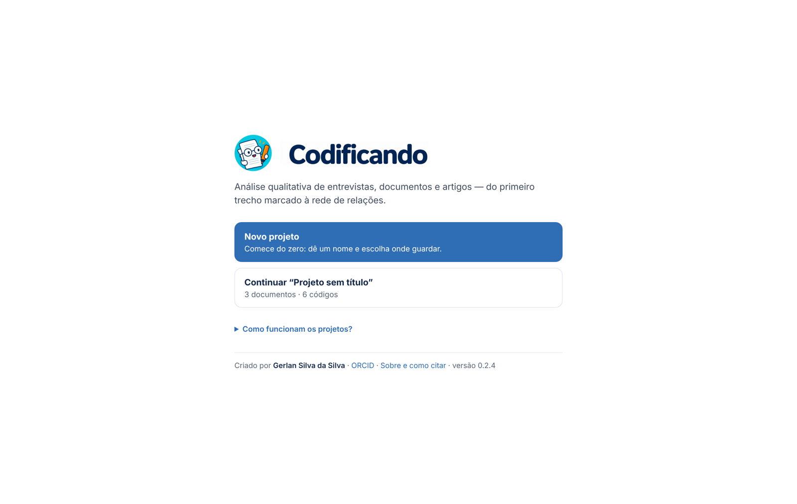

Ao abrir o programa pela primeira vez, aparece a tela inicial com três caminhos:

- **Novo projeto**: dê um nome e, se quiser, escreva a pergunta de pesquisa. No app
  instalado, ele pergunta onde guardar o arquivo.
- **Abrir projeto…**: escolhe um arquivo `.investigando` já existente.
- **Recentes**: os últimos projetos abertos, com um clique.

**Preciso criar um projeto antes?** Não. O programa salva tudo sozinho a cada alteração.
Criar ou usar "Salvar como…" só dá nome e lugar ao arquivo, o que facilita fazer cópias
e levar o projeto para outro computador.

**E se eu apagar ou mover o arquivo?** O programa não quebra. Ele avisa que não encontrou
o arquivo, tira o projeto da lista de recentes e não grava nada por cima. Se você só moveu,
use "Abrir projeto…" e escolha o novo local. Cópias automáticas ficam em
**Configurações → Backups**.

Para voltar à tela inicial depois: menu **⋯** ao lado do nome do projeto → **Tela inicial**.

## 2. A tela do projeto

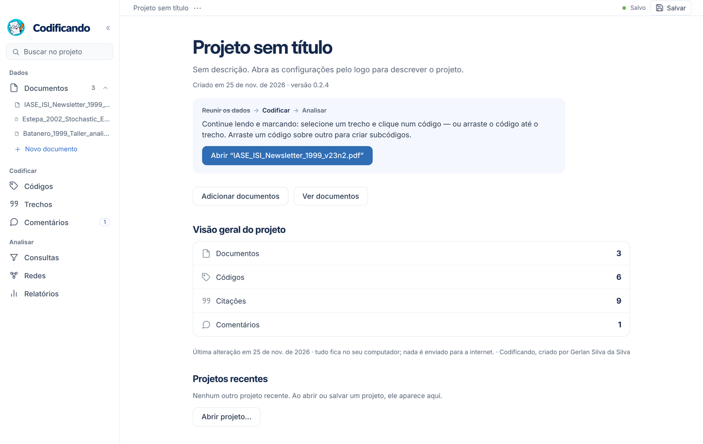

A tela do projeto mostra os números do estudo e, no quadro azul, **o próximo passo**:
o que fazer agora, com um botão que leva direto até lá.

## 3. Codificar: selecione, clique ou arraste

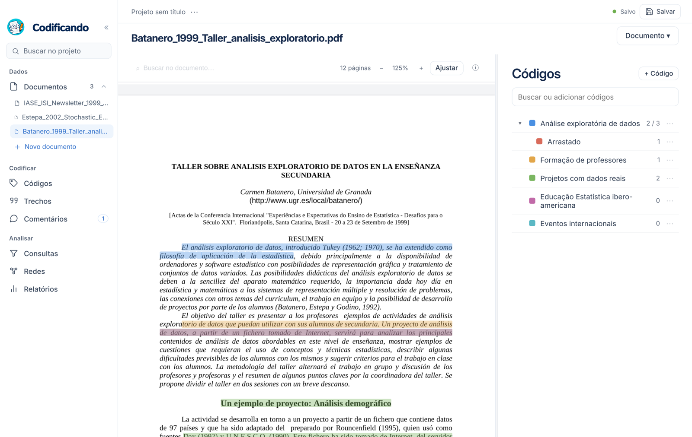

Abra um documento em **Documentos**. O PDF aparece como página, com o zoom ajustado à
largura (o zoom fica guardado para cada documento). À direita ficam os códigos.

Há três jeitos de codificar, use o que for mais natural:

1. **Clicar**: selecione um trecho e clique num código.
2. **Digitar**: selecione um trecho, digite o nome de um código novo e pressione Enter.
3. **Arrastar**, como no ATLAS.ti:

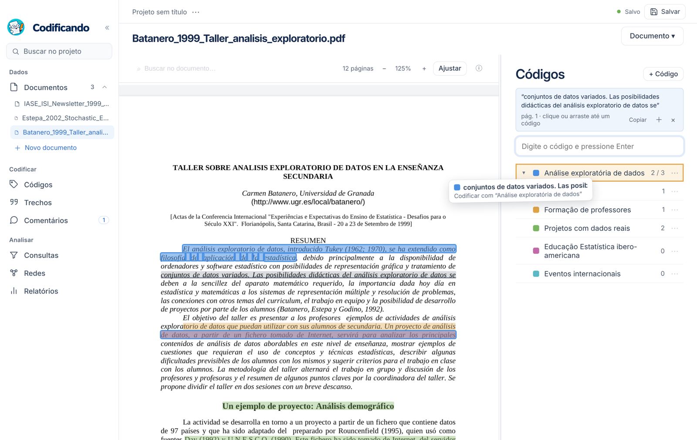

| Você arrasta… | …e solta sobre | Resultado |
|---|---|---|
| a seleção | um código | o trecho é codificado |
| um código | um trecho já marcado | o código é somado àquela citação |
| um código | a seleção atual | o código é aplicado |
| um código | outro código | menu: **Tornar subcódigo**, **Colocar logo abaixo** ou **Mesclar** |

Uma etiqueta acompanha o cursor e diz o que vai acontecer quando você soltar.

### Figuras, gráficos e quadros

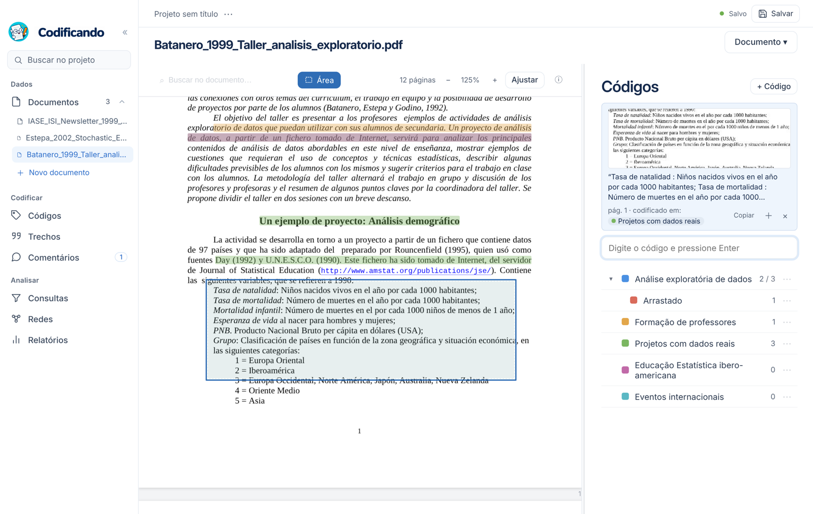

Para codificar uma imagem, um gráfico ou um quadro que está dentro do PDF, ligue o botão
**▭ Área** na barra do documento (ou aperte **A**) e desenhe um retângulo sobre a região.
O recorte vira uma citação como as outras: clique num código ou arraste o recorte até ele.
A citação guarda uma miniatura da região e, se houver texto dentro dela (rótulos de
gráfico, células de quadro), esse texto também. Aperte **A** de novo para voltar à
seleção de texto.

Outras ajudas:

- A faixa no alto do painel mostra o trecho selecionado e em quais códigos ele já está.
- **Ctrl/⌘ + Enter** aplica o último código usado.
- **Delete** remove a citação aberta; **Ctrl/⌘ + Z** desfaz.
- **Esc** limpa a seleção.

## 4. Organizar os códigos

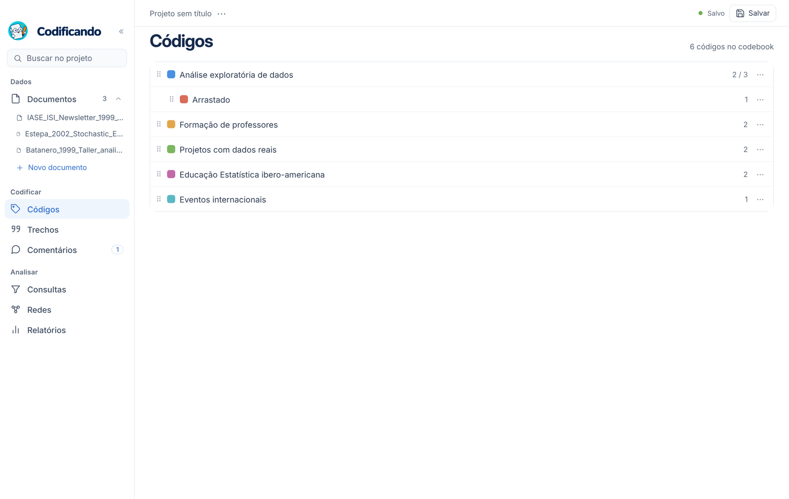

Em **Códigos** ficam a hierarquia, as cores, as definições e as contagens. Para criar temas
ou categorias, arraste códigos para dentro de outros, aqui ou no próprio editor.

## 5. Rever os trechos

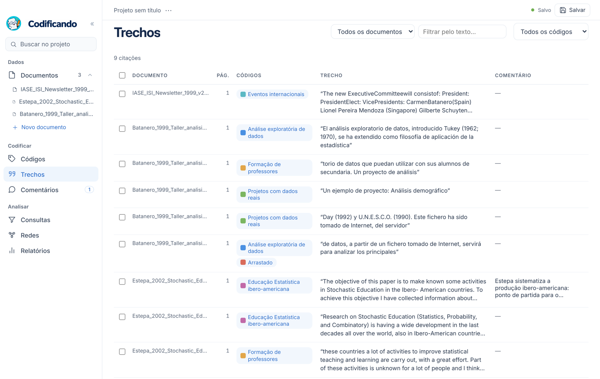

**Trechos** reúne todas as citações, com até três linhas de texto e o comentário logo ao
lado. Filtre por documento, código ou palavra. Marque várias linhas para codificar, mover,
comentar ou excluir em lote. Um clique abre o trecho no documento.

## 6. Cruzar códigos

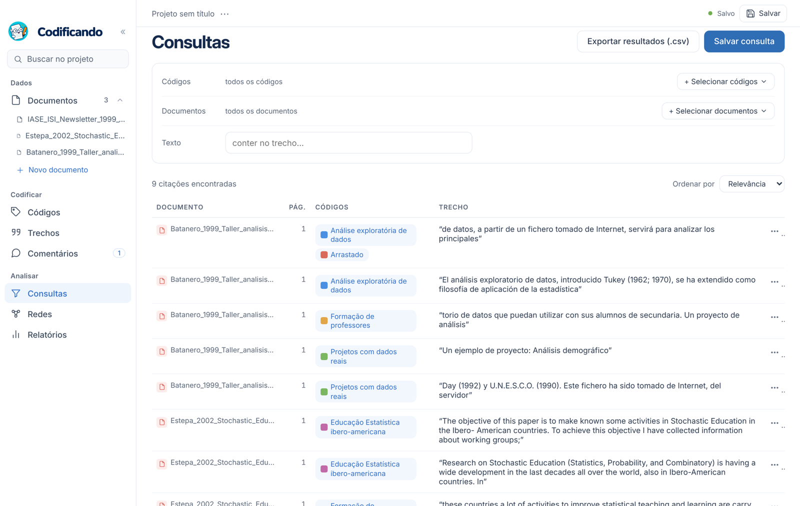

**Consultas** combina códigos (E, OU, NÃO) e responde perguntas como "em quais trechos
*formação de professores* aparece junto com *dados reais*?". As consultas ficam salvas.

## 7. Desenhar a rede

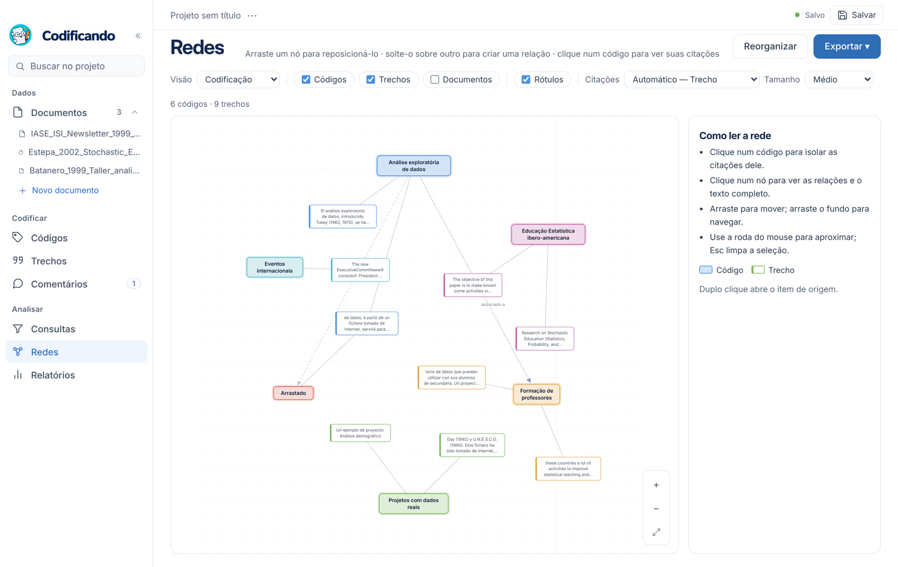

Em **Redes**:

- **Arraste** um nó para mudar a posição; arraste o fundo para navegar.
- **Solte um nó sobre outro** para criar uma relação ("explica", "contradiz",
  "é parte de"… ou um rótulo seu).
- **Clique** num código para ver só as citações dele.
- **Exportar ▾**: imagem vetorial (`.svg`), figura de 16 cm para artigo (`.svg`)
  ou imagem `.png` de 3000 × 3000 px.

As caixas dos códigos têm fundo claro na cor do código, para o texto ficar legível com
qualquer cor, inclusive na impressão.

## 8. Relatórios

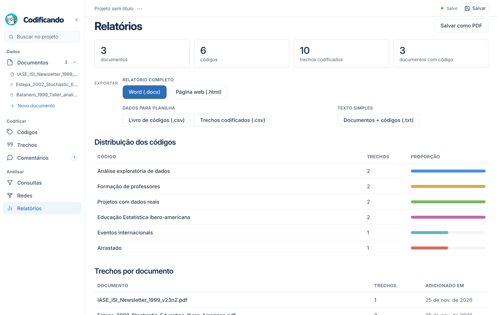

As exportações estão agrupadas pelo uso:

- **Relatório completo**: Word (`.docx`) ou página web (`.html`).
- **Dados para planilha**: livro de códigos e trechos em `.csv`.
- **Texto simples**: documentos com os códigos em `.txt`.

## 9. Como citar o Codificando

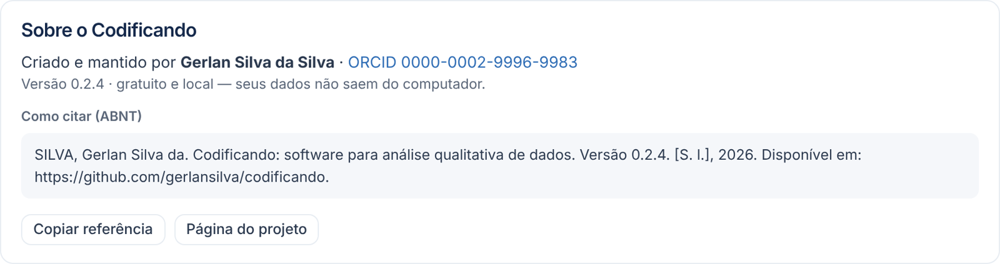

Em **Configurações → Sobre o Codificando** há a referência pronta para copiar:

> SILVA, Gerlan Silva da. *Codificando*: software para análise qualitativa de dados.
> Versão 0.3.0. [S. l.], 2026. Disponível em: https://github.com/gerlansilva/codificando.
